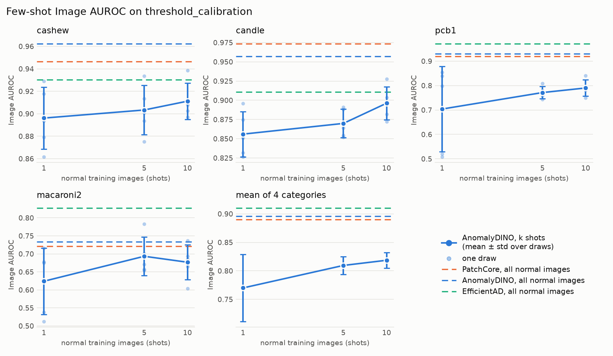
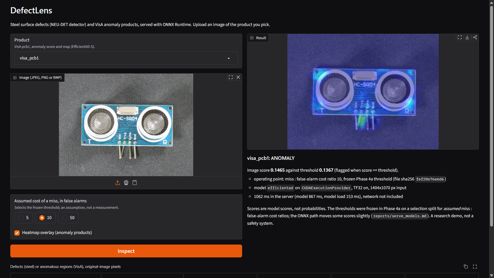
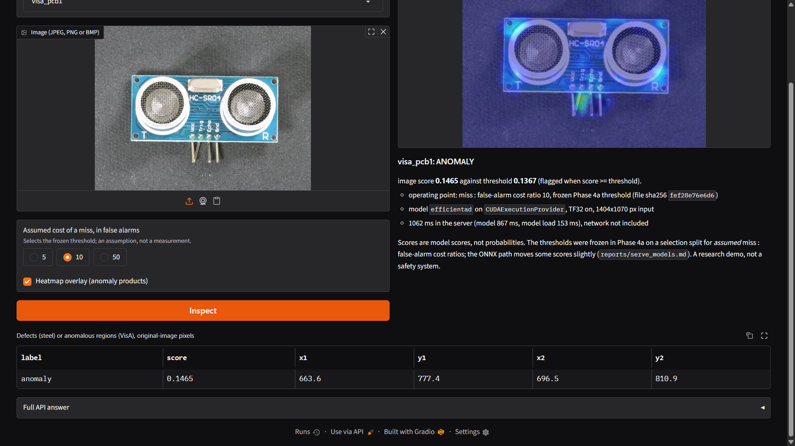
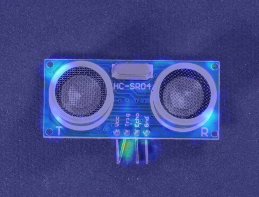
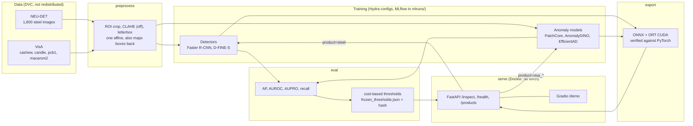

# DefectLens

[](https://github.com/shubhamvijaykawde/DefectLens/actions/workflows/ci.yml)
[-blue.svg)](LICENSE)

DefectLens is an industrial visual-inspection pipeline built to run on one 8 GB laptop GPU with free tools only. A
supervised detector finds the *known* defects of hot-rolled steel (NEU-DET, six classes), and anomaly detectors trained on
normal images only look for *unseen* defects on four VisA categories (cashew, candle, pcb1, macaroni2). Operating
thresholds are chosen on a cost model and frozen before one evaluation, the models are exported to ONNX and checked against
PyTorch, and a FastAPI service with a Gradio demo serves them from a GPU Docker image. It is a portfolio project: the
results below are one seed, small splits and one machine, and the README says where they do not support a claim. The answer
to the project's central question (does the anomaly path catch defect types the detector never saw?) is **weakly yes, decided
for one type of four** (see [Unseen defect types](#unseen-defect-types-leave-one-type-out)).

Every number in this README is copied by `scripts/build_report_tables.py` from `reports/` (which come from MLflow runs or
recorded script output) or quoted from a report named next to it. Anything not measured says TODO.

## Results

### Known defects: detector comparison (NEU-DET, test split)

<!-- generated:detectors -->
| detector (test) | AP@50 | AP@50:95 | recall@0.5 | precision@0.5 | FP/img@0.5 |
|---|---|---|---|---|---|
| classical (class-agnostic) | 0.1072 | 0.0490 | 0.1990 | 0.0909 | 4.6296 |
| Faster R-CNN | 0.7613 | 0.4224 | 0.7771 | 0.6778 | 0.8593 |
| Faster R-CNN + scale/shift | 0.7921 | 0.4319 | 0.8535 | 0.5648 | 1.5296 |
| D-FINE-S | 0.7304 | 0.4442 | 0.6927 | 0.7411 | 0.5630 |

*Generated from `reports/detection_comparison.md` by `scripts/build_report_tables.py`; edit the reports, not this table.*
<!-- /generated:detectors -->

Faster R-CNN (ResNet50-FPN v2) with the same scale/shift augmentation as D-FINE has the best AP@50 and recall, D-FINE-S the
best AP@50:95 and precision; neither is shown to be the better architecture. The recipes still differ (input 480 vs 640 px,
SGD vs AdamW, 30 vs 40 epochs), there is one seed per model and 270 test images, and D-FINE's best epoch was its last, so it
may be under-trained. Crazing and rolled-in scale are the weak classes for every detector. The classical OpenCV baseline is
class-agnostic and weak, as expected. Per-class results, training protocol and confusion matrices:
[reports/detection_comparison.md](reports/detection_comparison.md).

### Unseen defects: anomaly models (VisA, `threshold_calibration` half)

<!-- generated:anomaly -->
| image AUROC | PatchCore | AnomalyDINO | EfficientAD |
|---|---|---|---|
| cashew | 0.9464 | 0.9624 | 0.9304 |
| candle | 0.9736 | 0.9572 | 0.9108 |
| pcb1 | 0.9188 | 0.9304 | 0.9716 |
| macaroni2 | 0.7208 | 0.7336 | 0.8268 |
| **mean image AUROC** | 0.8899 | 0.8959 | 0.9099 |
| mean pixel AUROC | 0.9800 | 0.9775 | 0.9652 |
| mean AUPRO | 0.9079 | 0.8620 | 0.8619 |

*Generated from `reports/anomaly_comparison.md` by `scripts/build_report_tables.py`; edit the reports, not this table.*
<!-- /generated:anomaly -->

No model wins everywhere. EfficientAD has the best mean image AUROC and is far ahead on macaroni2; PatchCore has the best
mean AUPRO (how well whole defect regions are covered); macaroni2 is hard for all three. With 75-100 images per category,
one seed and no intervals, differences of 0.01-0.02 in mean image AUROC are not shown to be meaningful. Training cost is not
comparable between the models (a coreset, an embedding pass, 70,000 gradient steps); see
[reports/anomaly_comparison.md](reports/anomaly_comparison.md) for run ids, resources and the notes.

### Few-shot AnomalyDINO

<!-- generated:few_shot -->
| AnomalyDINO, image AUROC | 1-shot | 5-shot | 10-shot | full data |
|---|---|---|---|---|
| cashew | 0.8962 ± 0.0274 | 0.9034 ± 0.0219 | 0.9112 ± 0.0161 | 0.9624 |
| candle | 0.8560 ± 0.0294 | 0.8699 ± 0.0186 | 0.8962 ± 0.0214 | 0.9572 |
| pcb1 | 0.7039 ± 0.1747 | 0.7714 ± 0.0251 | 0.7902 ± 0.0333 | 0.9304 |
| macaroni2 | 0.6241 ± 0.0920 | 0.6934 ± 0.0532 | 0.6768 ± 0.0484 | 0.7336 |
| mean | 0.7700 ± 0.0588 | 0.8095 ± 0.0157 | 0.8186 ± 0.0138 | 0.8959 |

*Generated from `reports/anomaly_comparison.md` by `scripts/build_report_tables.py`; edit the reports, not this table.*

Each cell: mean ± sample standard deviation over 5 saved draws (n = 5).
<!-- /generated:few_shot -->

From 1 to 5 normal images helps (mean +0.040); from 5 to 10 does not clearly (+0.009, inside the draw spread). Ten shots stay
below full data in every category and below full-data PatchCore and EfficientAD in the mean, and a single bad 1-shot image
can drop a draw to chance. Only AnomalyDINO was run few-shot. 

### Cost-based thresholds

<!-- generated:thresholds -->
| VisA, evaluation cost (4 categories) | ratio 5 | ratio 10 | ratio 50 |
|---|---|---|---|
| AnomalyDINO | 105 | 129 | 201 |
| EfficientAD | 136 | 146 | 226 |
| PatchCore | 153 | 152 | 274 |
| best constant policy | 175 | 175 | 175 |

| NEU-DET, test cost | ratio 5 | ratio 10 | ratio 50 |
|---|---|---|---|
| Faster R-CNN | 918 | 1403 | 4296 |
| Faster R-CNN + scale/shift | 871 | 1359 | 3440 |
| D-FINE-S | 1005 | 1578 | 4109 |
| best constant policy | 3140 | 6280 | 31400 |

*Generated from `reports/thresholds.md` by `scripts/build_report_tables.py`; edit the reports, not this table.*

Cost = ratio x missed + false alarms; the ratios 5, 10 and 50 are assumptions. Thresholds were frozen on the selection splits and evaluated once.
<!-- /generated:thresholds -->

Cost = `fn_fp_ratio * missed + false alarms`; the ratios 5, 10 and 50 are *assumptions*, not measured costs. Thresholds were
chosen on the selection splits, written to `reports/frozen_thresholds.json` with a hash, and evaluated once; the code
refuses to select on evaluation data or to re-evaluate changed thresholds. All nine NEU-DET thresholds beat the best constant
policy by a wide margin. On VisA, 25 of 36 thresholds beat it on the evaluation half, 3 tie and 8 are worse
([reports/thresholds.md](reports/thresholds.md)); thresholds chosen on 75-100 images carried over only partly, and on
macaroni2 (weak ranking) no threshold helps. The lowest VisA total is AnomalyDINO's at every ratio, but that order is driven by
a handful of misses and is not shown to be meaningful. NEU-DET `val` also chose the checkpoints, so its selection-side costs
are optimistic.

### Unseen defect types: leave-one-type-out

<!-- generated:unseen -->
| held-out type (never seen by the detector) | images | Faster R-CNN | PatchCore | AnomalyDINO | EfficientAD |
|---|---|---|---|---|---|
| bent | 9 | 6/9 | 9/9 | 9/9 | 6/9 |
| melt | 28 | 15/28 | 17/28 | 16/28 | 24/28 |
| missing | 7 | 0/7 | 6/7 | 4/7 | 5/7 |
| scratch | 13 | 10/13 | 9/13 | 8/13 | 13/13 |

| type | images | detector, type held out | detector, type trained on | McNemar p (uncorrected) |
|---|---|---|---|---|
| bent | 9 | 6/9 | 9/9 | 0.250 |
| melt | 28 | 15/28 | 24/28 | 0.022 |
| missing | 7 | 0/7 | 5/7 | 0.062 |
| scratch | 13 | 10/13 | 13/13 | 0.250 |

*Generated from `reports/unseen_defects.md`, `reports/unseen_followup.md` by `scripts/build_report_tables.py`; edit the reports, not this table.*

Images caught / images that contain the type, evaluation half, at a 5% false-alarm budget set on the calibration normals; confidence intervals are in the reports. The second table is the exploratory follow-up (outside the approved protocol).
<!-- /generated:unseen -->

VisA pcb1 has four defect types. For each type, a Faster R-CNN is trained without it and compared with the three anomaly
models (which never see any anomaly) at the same false-alarm budget. Protocol, intervals and notes:
[reports/unseen_defects.md](reports/unseen_defects.md).

**Verdict: weakly supports the claim, decides it for one type, contradicts it for none, and cannot decide it overall.**
`missing` is the clear case: the detector trained without it flags 0/7 [0.00, 0.35] while PatchCore flags 6/7 [0.49, 0.97] at
the same 2/50 false alarms. `melt` depends on the anomaly model (EfficientAD 24/28 against the detector's 15/28), `bent` and
`scratch` are within noise, and no anomaly model wins on every type. The detector is not simply weak: on the types it was
trained on it catches 44/50 in the control run, above every anomaly model, so the anomaly path is a complement, not a better
detector. The exploratory follow-up (second table) shows the held-out detector catching fewer images of a type than when it
was trained on it, in all four types as point estimates, but the held-out detectors also train on fewer images and each is one
seed, so it does not isolate novelty; the verdict stands
([reports/unseen_followup.md](reports/unseen_followup.md)). Limits: 7-28 unseen images per type, one category, one seed, no
AUROC intervals, and `threshold_evaluation` was read a second time for this question under a disclosed owner decision.

### ONNX Runtime and TF32

<!-- generated:onnx -->
| D-FINE-S on NEU-DET val | AP@50 | AP@50:95 | images within 1e-3 | top-100 overlap |
|---|---|---|---|---|
| torch_fp32_strict | 0.7103 | 0.4345 | 270/270 | 1.0000 |
| torch_fp32_default | 0.7102 | 0.4346 | 0/270 | 0.7113 |
| torch_amp | 0.7109 | 0.4345 | 0/270 | 0.5976 |
| ort_tf32_off | 0.7103 | 0.4345 | 233/270 | 0.9998 |
| ort_tf32_on | 0.7103 | 0.4345 | 0/270 | 0.7119 |

| model, p50 ms (batch 1) | PyTorch fp32 (strict) | ORT CUDA, TF32 off | ORT CUDA, TF32 on | ORT device MiB (TF32 off) |
|---|---|---|---|---|
| anomaly_dino (pcb1) | 36.45 | 28.71 | 23.21 | 4960 |
| dfine_s | 27.45 | 30.89 | 28.87 | 560 |
| efficientad (pcb1) | 13.77 | 12.95 | 9.03 | 642 |
| faster_rcnn | 77.56 | 77.01 | 45.94 | 1332 |
| patchcore (pcb1) | 10.88 | 10.44 | 9.20 | 960 |

*Generated from `reports/benchmark.md` by `scripts/build_report_tables.py`; edit the reports, not this table.*

`torch_fp32_strict` is PyTorch fp32 with TF32 off; `faster_rcnn` is the exported `faster_rcnn_aug` checkpoint; the anomaly models were timed on pcb1; device memory is the device-wide peak of the row and includes the CUDA context. Model only, batch 1, one run per row.
<!-- /generated:onnx -->

- All five trained models export to ONNX (opset 20, batch 1). The Dynamo exporter fails on Faster R-CNN (a data-dependent size in
  torchvision's detection head); the TorchScript exporter works.
- With TF32 off, ONNX Runtime reproduces PyTorch fp32 on D-FINE-S's detection metrics (identical to four decimals) though not slot
  for slot on every image. With TF32 on the raw outputs change (no image within 1e-3, top-100 overlap 0.71) but the metrics do
  not: AP@50:95 differs by -0.0000 [-0.0013, +0.0009] on val (paired bootstrap), and PyTorch's own default and the AMP path
  differ from strict fp32 just as much. The Phase 0c spike's "TF32 breaks D-FINE" was true of the raw outputs, not of detection
  quality ([reports/benchmark.md](reports/benchmark.md)).
- ONNX Runtime is **not uniformly faster than PyTorch eager** here (D-FINE-S 30.89 vs 27.45 ms). The export gives a portable,
  verified artefact, not speed. TF32 matters for the convolution-heavy models (Faster R-CNN 77.01 to 45.94 ms). AnomalyDINO
  needs about 4.9 GB of device memory under ONNX Runtime, which is why it is not served.
- One machine (RTX 4060 Laptop, WSL2), one run per row, model only (no pre- or post-processing). TensorRT was not attempted
  (Phase 5b, optional): TODO.

### Served models and the Docker image

<!-- generated:served -->
| product | model | TF32 | device MiB | flips with TF32 on |
|---|---|---|---|---|
| steel | Faster R-CNN + scale/shift | off | 1332 | 66 |
| visa_cashew | EfficientAD | on | 642 | 0 |
| visa_candle | PatchCore | off | 960 | 0 |
| visa_pcb1 | EfficientAD | on | 642 | 0 |
| visa_macaroni2 | EfficientAD | on | 642 | 0 |

*Generated from `reports/serve_models.md` by `scripts/build_report_tables.py`; edit the reports, not this table.*

Flips with TF32 on: VisA, images on the other side of the frozen threshold than under PyTorch; steel, image-ratio pairs with a different number of kept boxes (no image is defect-free, so alarm flips cannot occur). The rule and the reasoning are in the report.
<!-- /generated:served -->

One model per product, so steel and VisA are never fused. The choices are mine and the owner's, recorded in
[reports/serve_models_notes.md](reports/serve_models_notes.md):

- **Anomaly models: a rule, not a result.** EfficientAD unless another model beats it by more than 0.05 image AUROC on
  `threshold_calibration`; the owner confirmed this rule on 2026-11-09. It picks PatchCore for candle (+0.063) and EfficientAD
  elsewhere. The 0.05 cut-off is a judgement made after reading the AUROC table; with 75-100 images and one seed a gap of 0.03 and
  a gap of 0.06 are both small, and highest-AUROC-per-category would serve AnomalyDINO for cashew.
- **Steel stays the augmented Faster R-CNN** (lowest cost on `val` at every ratio); D-FINE-S is implemented behind a config switch.
- **Frozen thresholds on ONNX Runtime.** The thresholds were set on PyTorch scores; the API scores with ONNX Runtime. On the
  selection splits 0 of 375 VisA images change side, but the nearest image sits only 0.27-1.61% from its threshold while the two
  paths differ by up to 1.41%, so unseen images within about 1% of a threshold can flip. For steel, no image changes alarm
  status (none is defect-free) but the val cost at the frozen threshold rises by 2.9% / 1.4% / 2.4% (ratio 5 / 10 / 50). The
  thresholds were kept and the shift is disclosed. The CPU fallback path is not checked.
- **Known weak product:** `visa_macaroni2` flags 44 of 50 normal calibration images at its frozen threshold; its flags say little.
- **Live check** (one sequential client, warm, server-side p50): steel 75.2 ms, pcb1 27.6 ms, candle 31.0 ms; no load test, no
  authentication.

<!-- generated:docker -->
| Docker image, one smoke run | measured |
|---|---|
| date of the run | 2026-11-09 |
| image size (`docker image inspect .Size`) | 5,216,981,475 bytes (4.859 GiB) |
| files inside the image (`du -sx /`) | 3,189 MiB |
| smoke checks passed | 9 |
| provider with `--gpus=all` | CUDAExecutionProvider |
| provider without a GPU | CPUExecutionProvider (with a fallback reason) |
| first `/inspect` steel, with model load | 1818 ms (load 1014 ms) |
| first `/inspect` visa_pcb1, with model load | 155 ms (load 106 ms) |

*Generated from `reports/docker_smoke.json` by `scripts/build_report_tables.py`; edit the reports, not this table.*
<!-- /generated:docker -->

The synthetic test image used by the smoke test shows that the service works, not that its answers are good. The first image
built ran on CPU because `onnxruntime-gpu[cuda]` does not install cuBLAS or cuDNN (locally torch provides them); `/health`
reported CPU and the reason, and the two packages were added to the `serve-gpu` group.

### What the service returns

A VisA image through the demo's own code path (`inspect_for_demo`, the function the Gradio button runs), product `visa_pcb1`,
cost ratio 10. The image is the first anomalous image of the `threshold_calibration` half, `pcb1/Data/Images/Anomaly/001.JPG`
(defect type `bent`); it was not picked for how it looks, and one example proves nothing about quality. The score was 0.1465
against the frozen threshold 0.1367, so it is flagged; the one region returned (x 663.6-696.5, y 777.4-810.9 in the original
1404 x 1070 pixels) overlaps the annotated mask's box (x 646-686, y 752-882).



*Screenshot 1 of the Gradio demo (`/demo`), top of the page: product `visa_pcb1`, the uploaded VisA image, the heatmap result and
the verdict (ANOMALY, score 0.1465 against threshold 0.1367). Image content: VisA, Y. Zou et al., 2022, accessed from
<https://registry.opendata.aws/visa>, licence CC BY 4.0 per the registry (see the note under the overlay image).*



*Screenshot 2, the same run scrolled down: the cost-ratio and heatmap controls, the *Inspect* button, the returned region
(x 663.6-696.5, y 777.4-810.9) and the collapsed "Full API answer" panel. Image content: VisA, Y. Zou et al., 2022, accessed from
<https://registry.opendata.aws/visa>, licence CC BY 4.0 per the registry (see the note under the overlay image).*



*Image: VisA, Y. Zou et al., 2022, accessed from <https://registry.opendata.aws/visa>. The heatmap overlay was drawn by this
project's demo (colour = anomaly map / (2 x threshold), so the threshold is mid-scale). This is the demo's output picture, not a
screenshot of the browser page.*

*Licence of these images: they follow the dataset's terms (CC BY 4.0 per the registry; the registry and earlier sources
conflict, see [Dataset terms](#dataset-terms-and-citations)), **not** the MIT licence of the code.*

**Steel, described in text only** (NEU-DET states no licence, so no NEU-DET image is in this repository). `steel` on
`crazing_109.jpg`, the first image of the `val` split, at cost ratio 10 (threshold 0.315): five boxes, all labelled `crazing`,
with scores 0.9385, 0.9343, 0.811, 0.7452 and 0.3546, on `CUDAExecutionProvider` with TF32 off. The file name gives the image's
class; the boxes were not compared with the annotation, so this is an illustration of the output, not a measurement.

## Architecture



The last two arrows show routing: `product` picks exactly one model, so steel and VisA are never fused. Weights are mounted
into the container, never baked in.

## Quickstart

Needs WSL2 Ubuntu or Linux, an NVIDIA GPU with a current driver (the Docker route also needs the NVIDIA container runtime),
`uv`, `git`, and Docker for the last step. Everything is free software.

```bash
git clone https://github.com/shubhamvijaykawde/DefectLens.git
cd DefectLens
uv sync                             # locked env from uv.lock, CUDA 13 torch build
uv run python scripts/check_env.py  # torch / CUDA / ONNX Runtime provider status
```

The first `uv sync` took 9 min 23 s here and the `.venv` is 7.0 GB (measured once, Phase 0b). For a CPU-only environment (what CI
uses): `uv sync --locked --no-default-groups --group cpu --group serve --group dev`; then use `uv run --no-sync`.

**Data** (not in git; official sources and terms in [docs/DATA_TERMS.md](docs/DATA_TERMS.md)):

```bash
uv run python scripts/download_neu_det.py   # 27 MB from the official link, sha256 checked
uv run python scripts/download_visa.py      # 1.93 GB, sha256 checked
uv run python scripts/prepare_data.py       # COCO files and the fixed splits, deterministic
```

**Weights are not distributed.** The terms for trained weights are unresolved (see below), so a clean clone has no ONNX files
and the container has nothing to serve until you make them. The commands are the ones the reports were made with; the times are
the ones measured in this project (one RTX 4060 Laptop), about 4.2 h of GPU time in total (the sum of the measured times:
2,470 s + 3 x about 4,190 s + 63 s):

```bash
# steel: Faster R-CNN with scale/shift augmentation (2,470 s, 1,752 MiB peak VRAM allocated)
uv run python scripts/train_detector.py model=faster_rcnn +model.augment.scale_translate=0.5 \
    +model.run_name=faster_rcnn_aug model.checkpoint_dir=models/faster_rcnn_aug
# VisA: EfficientAD (about 70 min per category, 1,202 MiB peak VRAM) and PatchCore for candle (63 s fit)
uv run python scripts/train_anomaly.py model=efficientad category=cashew,pcb1,macaroni2
uv run python scripts/train_anomaly.py model=patchcore category=candle
uv run python scripts/export_onnx.py models=faster_rcnn,efficientad,patchcore   # about 1 minute, CPU
```

The frozen thresholds in `reports/frozen_thresholds.json` belong to the models trained in this project. Whether a retrained
model scores close enough to them is **not verified**; the thresholds are applied as frozen.

**Run and call the service:**

```bash
docker build -t defectlens:local .
docker run --rm --gpus=all -p 8000:8000 -v "$PWD/models:/app/models:ro" defectlens:local   # or: docker compose up
curl localhost:8000/health ; curl localhost:8000/products
curl -F image=@data/raw/neu_det/NEU-DET/IMAGES/crazing_109.jpg "localhost:8000/inspect?product=steel"
curl -F image=@data/raw/visa/pcb1/Data/Images/Anomaly/001.JPG "localhost:8000/inspect?product=visa_pcb1&fn_fp_ratio=10"
```

The demo is at <http://localhost:8000/demo>. Without `--gpus` the same image serves on CPU and `/health` says so and why. No
Docker: `uv run python scripts/serve.py` (port 8000). `tests/fixtures/sample.jpg` is a synthetic 200 x 200 image that only
shows the service answers; its output means nothing. `POST /inspect` takes JPEG, PNG or BMP and `product` (`steel`,
`visa_cashew`, `visa_candle`, `visa_pcb1`, `visa_macaroni2`); `fn_fp_ratio` is 5, 10 (default) or 50; answers carry the
operating point (threshold, ratio, SHA-256 of the frozen file), the provider, the TF32 setting and timings. Errors: 400 not an
image, 404 unknown product, 413 too large, 422 bad parameter, 503 model missing or not loadable.

Checks (all CPU, fast): `uv run pytest` (345 tests in 40 s here), `uv run pytest -m slow` (the 6 tests above 5 s, 107 s here), `uv run ruff check .`,
`uv run mypy src`. Without weights, `bash scripts/docker_static_checks.sh --tag defectlens:local` checks the built image
(no GPU, no model); with the weights and a GPU, `bash scripts/docker_smoke.sh` is the full smoke test.

## Reproducibility

- **Environment:** Python 3.11, `uv.lock` pins everything (`uv sync --locked`); the CUDA and CPU torch builds are separate
  dependency groups; the Docker image installs only the `serve` and `serve-gpu` groups of the same lockfile.
- **Seeds and splits:** seed 42 for the splits, the few-shot draws and the full-data runs. NEU-DET is split 70/15/15 (1,260 / 270 / 270, stratified) and every VisA test set
  50/50 into `threshold_calibration` and `threshold_evaluation`; the splits are saved in `data/splits/` and never re-drawn
  (few-shot draws included). Re-running `prepare_data.py` gives byte-identical files.
- **Protocol:** thresholds and models are chosen on selection splits only; evaluation splits are read once per question, and
  every extra read is disclosed in the reports (VisA `threshold_evaluation` was read for the frozen evaluation, for the
  leave-one-type-out runs, and read-only for the error gallery and the exploratory follow-up).
- **Tracking:** every experiment is an MLflow run (`sqlite:///mlruns/mlflow.db`, artifacts in `mlruns/artifacts`, git-ignored)
  logging config, seed, git commit hash and dataset version. Run ids are in the reports.
- **Regenerating the reports:** `compare_detectors.py`, `compare_anomaly.py`, `evaluate_thresholds.py`, `render_unseen.py`,
  `render_unseen_followup.py`, `render_benchmark.py`, `render_serve_models.py` write the files in `reports/`;
  `uv run python scripts/build_report_tables.py` then rewrites the tables above (`--check` fails if they are out of date, and a
  test does the same). Run ids, commands and measured results per experiment are in the `reports/` files named above.
- **Data versioning:** data is tracked with DVC locally (`.dvc` files pin the hashes), but **no DVC remote is planned**, because
  the datasets cannot be redistributed. `dvc pull` therefore does not work from a clone; the download scripts above, which check
  sha256, are the documented route.
- **CI:** `.github/workflows/ci.yml` runs ruff, mypy, the fast and the slow tests on the CPU environment, and a Docker job that
  builds the image without pushing it and runs `scripts/docker_static_checks.sh`. It has not run yet (it needs a push), so its
  duration and the runner's free disk are TODO; the GPU smoke test cannot run on a hosted runner and stays local.

## Limitations

- **Statistics:** one seed per model, 270 images per NEU-DET split, 75-100 images per VisA half, mostly no confidence intervals
  on AUROC. Small gaps are not shown to be meaningful and are described that way.
- **Not like-for-like detector comparison:** augmentation, input size, optimizer, batch and epochs differ between Faster R-CNN
  and D-FINE-S.
- **No defect-free steel:** NEU-DET has no normal images, so false alarms on good steel cannot be measured and the steel alarm
  status never flips.
- **Cost ratios are assumed**, and the VisA halves are about 50% anomalous (67% for cashew), not a production defect rate.
- **Thresholds were frozen on PyTorch scores; the service scores with ONNX Runtime.** See the served-models notes above. The CPU
  path was not checked against them.
- **Weak products:** `visa_macaroni2` has a weak ranking (EfficientAD image AUROC 0.8268 on calibration) and its flags say little.
  Heatmap regions are derived from the anomaly map and were not evaluated as boxes (only pixel AUROC and AUPRO were).
- **The steel model was trained on 200 x 200 images**; other sizes get a warning.
- **Service:** one client tested, no load or concurrency test, no authentication or rate limiting; a model load blocks other
  requests for hundreds of ms.
- **Docker:** measured on one machine (WSL2 + Docker Desktop, RTX 4060 Laptop). Other GPUs and drivers, Linux without Docker
  Desktop, container memory and VRAM, a CPU-only image and the image size after pruning unused cuDNN engines are not measured.
- **Unseen-type test:** one category (pcb1), 7-28 unseen images per type, a detector trained on 23-47 images.
- **Not done:** TensorRT (Phase 5b, optional), own-image capture and calibration (Phase 7), synthetic-defect ablation (Phase 8).
  CLAHE's effect on detection is unmeasured (off by default).

## Licence

The code in this repository is under the [MIT licence](LICENSE), copyright 2026 Shubham Vijay Kawde. The licence covers the code
only. It does **not** cover the datasets (NEU-DET, VisA), trained weights, or the VisA-derived image(s) under `docs/images/`;
those follow the terms below.

## Dataset terms and citations

Details, exact wording and retrieval dates: [docs/DATA_TERMS.md](docs/DATA_TERMS.md). The datasets are not redistributed.

- **NEU-DET** (Kechen Song's group, Northeastern University): the official page states **no licence**; whether redistribution,
  commercial use or publishing trained weights is allowed is open. Not in this repository. Cite (the page's list): Y. He, K. Song,
  Q. Meng, Y. Yan, "An End-to-end Steel Surface Defect Detection Approach via Fusing Multiple Hierarchical Features," IEEE TIM
  69(4), 1493-1504, 2020; K. Song, Y. Yan, "A noise robust method based on completed local binary patterns for hot-rolled steel
  strip surface defects," Applied Surface Science 285, 858-864, 2013.
- **VisA:** "Visual Anomaly (VisA) was accessed on 2026-11-04 from https://registry.opendata.aws/visa." The registry lists CC BY 4.0
  and the archive's `LICENSE-DATASET` is the CC BY 4.0 text; earlier sources said CC BY-NC-SA 4.0 and that conflict is **not fully
  resolved**. Attribution is required either way. Cite: Y. Zou, J. Jeong, L. Pemula, D. Zhang, O. Dabeer, "SPot-the-Difference
  Self-Supervised Pre-training for Anomaly Detection and Segmentation," arXiv:2207.14315, 2022. VisA-derived images (the demo
  overlay and the demo screenshot above, in `docs/images/`) are in this repository under that attribution and these terms, not
  under the code licence.
- **Trained weights:** no licence or usage status is assumed, the terms of the pretrained checkpoints (COCO-pretrained detectors,
  D-FINE, DINOv2, WideResNet50) are not yet checked, and **the repository's MIT licence (code only) does not cover
  weights**. Publishing weights is the owner's decision after those terms are checked.
- **Methods used:** S. Ren et al., Faster R-CNN, arXiv:1506.01497; Y. Peng et al., D-FINE, arXiv:2410.13842 (ICLR 2025);
  K. Roth et al., PatchCore, arXiv:2106.08265; S. Damm et al., AnomalyDINO, arXiv:2405.14529 (WACV 2025); K. Batzner et al.,
  EfficientAD, arXiv:2303.14535; M. Oquab et al., DINOv2, arXiv:2304.07193. Libraries: PyTorch, torchvision, Hugging Face
  Transformers, timm, anomalib, ONNX Runtime, FastAPI, Gradio, Hydra, MLflow, DVC.
