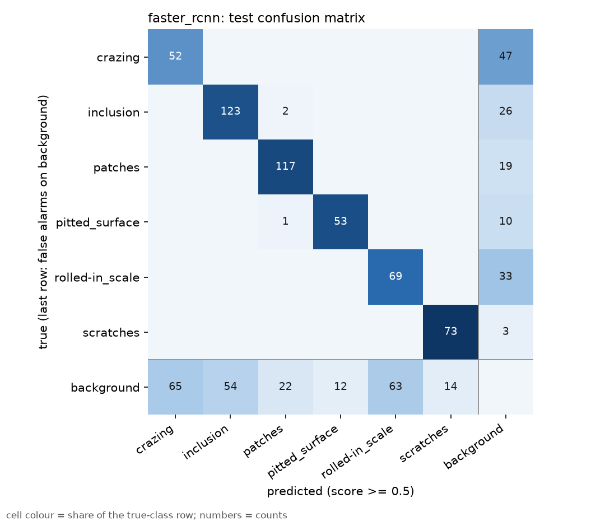
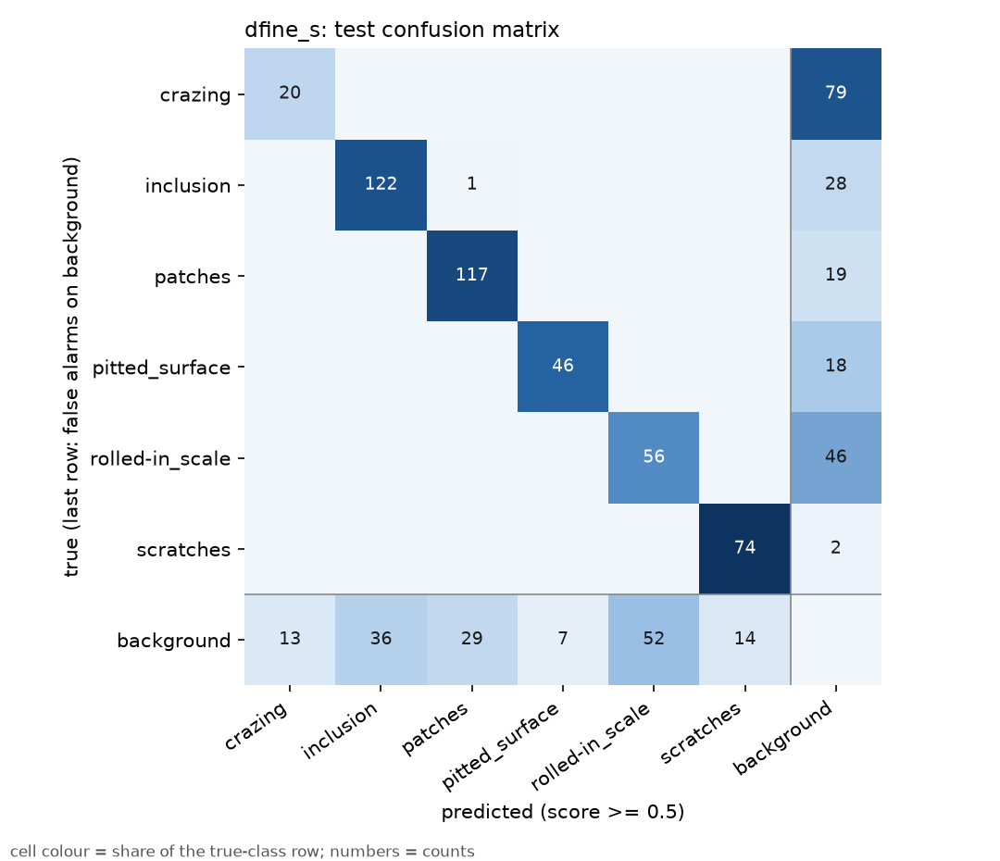

# Detector comparison

Generated by `scripts/compare_detectors.py` from MLflow runs `classical`=eae981c9, `faster_rcnn`=377b83c4, `dfine_s`=2f90dfc4. Val is read at each run's best epoch; test was scored once per run.

**Not a like-for-like comparison.** Training recipes differ, so differences below mix architecture
and recipe effects and cannot be attributed to either one:

- D-FINE-S was trained with scale/shift augmentation (`scale_translate`), 640 px input, effective
  batch 16, AdamW, and early stopping configured (patience 10); Faster R-CNN had flips and
  brightness/contrast only, 480 px, batch 4, SGD, and no early stopping.
- Both keep the best-val checkpoint (by val AP@50:95), so checkpoint selection is the same.
- Early stopping was configured for D-FINE but never fired (see the protocol table: epochs run
  vs. max), so in practice the difference is the augmentation, the epoch budget (40 vs 30) and the
  rest of the recipe above.
- One seed per detector and 270 images per split: small differences are not shown to be meaningful.
- recall, precision and FP/image are at a fixed score threshold of 0.5. D-FINE's sigmoid scores and
  Faster R-CNN's softmax scores are calibrated differently, so a fixed 0.5 favours one or the other;
  `recall_max` (any score) and the AP columns do not depend on it.
- The classical baseline is class-agnostic (AP and recall treat all defects as one class).

## Headline metrics

| detector | split | AP@50 | AP@50:95 | recall@0.5 | precision@0.5 | FP/img@0.5 | recall_max |
|---|---|---|---|---|---|---|---|
| classical | val | 0.0941 | 0.0408 | 0.2073 | 0.1004 | 4.5481 | 0.2073 |
| classical | test | 0.1072 | 0.0490 | 0.1990 | 0.0909 | 4.6296 | 0.1990 |
| faster_rcnn | val | 0.7228 | 0.3780 | 0.7398 | 0.6868 | 0.8259 | 0.9047 |
| faster_rcnn | test | 0.7613 | 0.4224 | 0.7771 | 0.6778 | 0.8593 | 0.9315 |
| dfine_s | val | 0.7105 | 0.4346 | 0.6641 | 0.7491 | 0.5444 | 0.9849 |
| dfine_s | test | 0.7304 | 0.4442 | 0.6927 | 0.7411 | 0.5630 | 0.9936 |

## Training protocol (from each run's logged config)

| detector | input | batch (x accum) | epochs max / run | early stopping | augmentation | best epoch | train time | peak VRAM |
|---|---|---|---|---|---|---|---|---|
| classical | n/a | n/a | n/a | n/a | n/a (non-learned) | n/a | n/a s | n/a |
| faster_rcnn | 480 | 4 x 1 | 30 / not logged | off | hflip 0.5, vflip 0.5, brightness_contrast 0.5 | 28 | 2452 s | 1752 MiB |
| dfine_s | 640 | 8 x 2 | 40 / 40 | patience 10 | hflip 0.5, vflip 0.5, brightness_contrast 0.5, scale_translate 0.5 | 40 | 2210 s | 3394 MiB |

## Per class (test)

| class | faster_rcnn AP@50 | faster_rcnn recall | dfine_s AP@50 | dfine_s recall |
|---|---|---|---|---|
| crazing | 0.4113 | 0.5253 | 0.3493 | 0.2020 |
| inclusion | 0.8108 | 0.8212 | 0.8474 | 0.8079 |
| patches | 0.9128 | 0.8603 | 0.9065 | 0.8603 |
| pitted_surface | 0.8540 | 0.8281 | 0.8236 | 0.7188 |
| rolled-in_scale | 0.6173 | 0.6765 | 0.4895 | 0.5490 |
| scratches | 0.9615 | 0.9605 | 0.9658 | 0.9737 |

## Confusion matrices (test, IoU 0.5, score >= 0.5)

### faster_rcnn

Correct class 487, wrong class 3, missed 138, false alarms on background 230.

### dfine_s

Correct class 435, wrong class 1, missed 192, false alarms on background 151.
