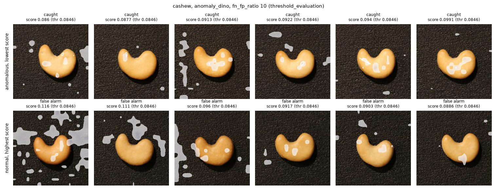
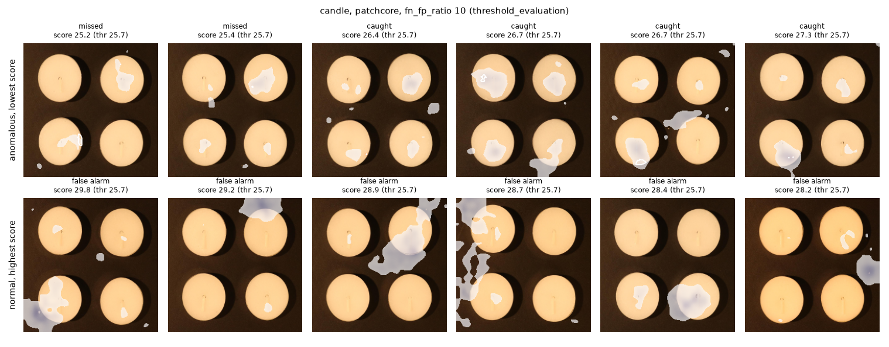
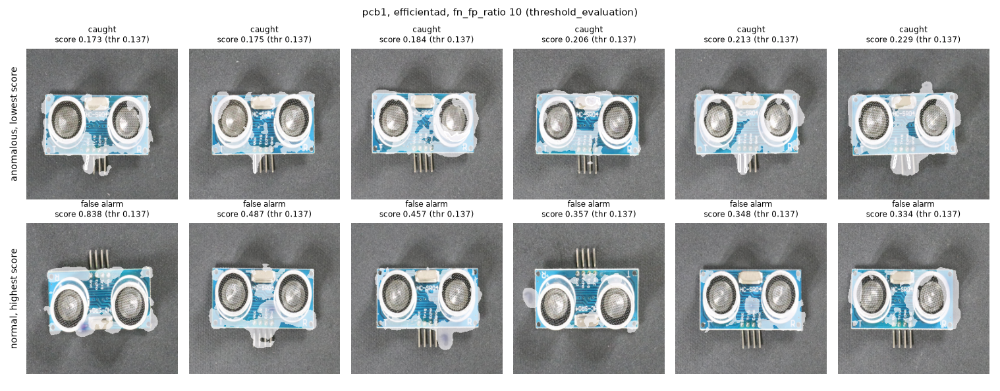
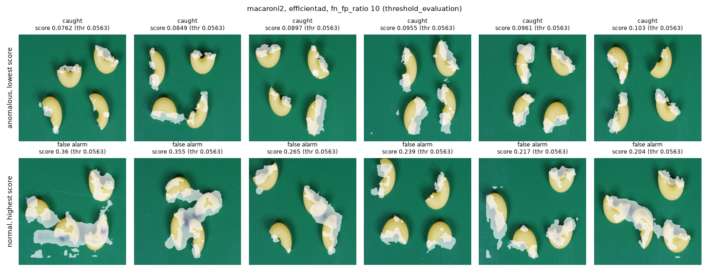
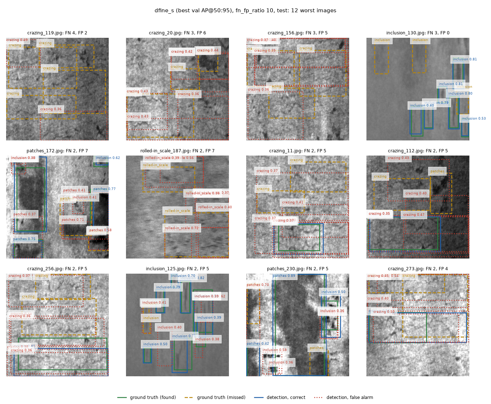

# Error gallery (Phase 4a)

Generated by `scripts/error_gallery.py`. It reads the evaluation splits (`threshold_evaluation`, `test`) at the frozen thresholds of `reports/frozen_thresholds.json` (SHA-256 `fef28e76e6d6233e16cdd1b3e251267d063efc678e0261519e7b1badcf401b1a`), for fn_fp_ratio = 10. It changes no threshold, and nothing here feeds back into one: a later change would need a new untouched subset or a disclosed result.

Figures show the lowest-scoring anomalous images and the highest-scoring normal images (VisA) and the worst images by `ratio * FN + FP` (NEU-DET). For VisA one model per category is drawn, the one with the best image AUROC on `threshold_calibration` (a calibration-side choice); the tables cover every model.

## VisA: summary at the frozen thresholds

| category | model | threshold | missed / anomalous | false alarms / normal | median defect area, missed | median defect area, caught |
|---|---|---|---|---|---|---|
| cashew | patchcore | 27.79 | 0 / 50 | 19 / 25 | - | 0.16% |
| cashew | anomaly_dino (drawn) | 0.08464 | 0 / 50 | 6 / 25 | - | 0.16% |
| cashew | efficientad | 0.0752 | 1 / 50 | 17 / 25 | 0.15% | 0.16% |
| candle | patchcore (drawn) | 25.74 | 2 / 50 | 15 / 50 | 0.09% | 0.16% |
| candle | anomaly_dino | 0.08661 | 2 / 50 | 11 / 50 | 0.09% | 0.16% |
| candle | efficientad | 0.07723 | 1 / 50 | 39 / 50 | 0.00% | 0.15% |
| pcb1 | patchcore | 32.76 | 1 / 50 | 32 / 50 | 0.26% | 0.21% |
| pcb1 | anomaly_dino | 0.07616 | 2 / 50 | 22 / 50 | 0.18% | 0.22% |
| pcb1 | efficientad (drawn) | 0.1367 | 0 / 50 | 25 / 50 | - | 0.22% |
| macaroni2 | patchcore | 34.68 | 1 / 50 | 46 / 50 | 0.03% | 0.05% |
| macaroni2 | anomaly_dino | 0.06783 | 0 / 50 | 50 / 50 | - | 0.05% |
| macaroni2 | efficientad (drawn) | 0.05634 | 0 / 50 | 45 / 50 | - | 0.05% |

## VisA: the drawn model per category

### cashew (anomaly_dino)

Lowest-scoring anomalous images (top 20):

| # | image | score | score - thr | outcome | defect area |
|---|---|---|---|---|---|
| 1 | `cashew/Data/Images/Anomaly/058.JPG` | 0.086 | +0.00137 | caught | 0.07% |
| 2 | `cashew/Data/Images/Anomaly/054.JPG` | 0.08771 | +0.00307 | caught | 0.08% |
| 3 | `cashew/Data/Images/Anomaly/075.JPG` | 0.09134 | +0.00671 | caught | 0.03% |
| 4 | `cashew/Data/Images/Anomaly/051.JPG` | 0.09215 | +0.00752 | caught | 0.13% |
| 5 | `cashew/Data/Images/Anomaly/090.JPG` | 0.09399 | +0.00935 | caught | 0.25% |
| 6 | `cashew/Data/Images/Anomaly/069.JPG` | 0.0991 | +0.0145 | caught | 0.02% |
| 7 | `cashew/Data/Images/Anomaly/067.JPG` | 0.1007 | +0.0161 | caught | 0.01% |
| 8 | `cashew/Data/Images/Anomaly/064.JPG` | 0.1041 | +0.0194 | caught | 0.02% |
| 9 | `cashew/Data/Images/Anomaly/062.JPG` | 0.1053 | +0.0207 | caught | 0.02% |
| 10 | `cashew/Data/Images/Anomaly/088.JPG` | 0.114 | +0.0294 | caught | 0.20% |
| 11 | `cashew/Data/Images/Anomaly/077.JPG` | 0.1146 | +0.0299 | caught | 0.03% |
| 12 | `cashew/Data/Images/Anomaly/057.JPG` | 0.1148 | +0.0302 | caught | 0.01% |
| 13 | `cashew/Data/Images/Anomaly/046.JPG` | 0.1165 | +0.0319 | caught | 0.19% |
| 14 | `cashew/Data/Images/Anomaly/003.JPG` | 0.1185 | +0.0339 | caught | 0.15% |
| 15 | `cashew/Data/Images/Anomaly/093.JPG` | 0.1192 | +0.0345 | caught | 0.17% |
| 16 | `cashew/Data/Images/Anomaly/002.JPG` | 0.1222 | +0.0376 | caught | 0.42% |
| 17 | `cashew/Data/Images/Anomaly/082.JPG` | 0.123 | +0.0383 | caught | 0.20% |
| 18 | `cashew/Data/Images/Anomaly/053.JPG` | 0.1243 | +0.0397 | caught | 0.06% |
| 19 | `cashew/Data/Images/Anomaly/089.JPG` | 0.1244 | +0.0398 | caught | 0.40% |
| 20 | `cashew/Data/Images/Anomaly/068.JPG` | 0.1248 | +0.0402 | caught | 0.02% |

Highest-scoring normal images (top 20):

| # | image | score | score - thr | outcome | defect area |
|---|---|---|---|---|---|
| 1 | `cashew/Data/Images/Normal/435.JPG` | 0.1157 | +0.031 | false alarm | - |
| 2 | `cashew/Data/Images/Normal/050.JPG` | 0.1108 | +0.0262 | false alarm | - |
| 3 | `cashew/Data/Images/Normal/098.JPG` | 0.09598 | +0.0113 | false alarm | - |
| 4 | `cashew/Data/Images/Normal/148.JPG` | 0.09165 | +0.00702 | false alarm | - |
| 5 | `cashew/Data/Images/Normal/093.JPG` | 0.09027 | +0.00564 | false alarm | - |
| 6 | `cashew/Data/Images/Normal/213.JPG` | 0.08859 | +0.00396 | false alarm | - |
| 7 | `cashew/Data/Images/Normal/484.JPG` | 0.0843 | -0.000334 | ok | - |
| 8 | `cashew/Data/Images/Normal/181.JPG` | 0.08256 | -0.00207 | ok | - |
| 9 | `cashew/Data/Images/Normal/089.JPG` | 0.0822 | -0.00243 | ok | - |
| 10 | `cashew/Data/Images/Normal/342.JPG` | 0.08182 | -0.00281 | ok | - |
| 11 | `cashew/Data/Images/Normal/130.JPG` | 0.07898 | -0.00566 | ok | - |
| 12 | `cashew/Data/Images/Normal/487.JPG` | 0.07602 | -0.00861 | ok | - |
| 13 | `cashew/Data/Images/Normal/369.JPG` | 0.0731 | -0.0115 | ok | - |
| 14 | `cashew/Data/Images/Normal/352.JPG` | 0.07253 | -0.0121 | ok | - |
| 15 | `cashew/Data/Images/Normal/307.JPG` | 0.07205 | -0.0126 | ok | - |
| 16 | `cashew/Data/Images/Normal/461.JPG` | 0.07063 | -0.014 | ok | - |
| 17 | `cashew/Data/Images/Normal/389.JPG` | 0.07046 | -0.0142 | ok | - |
| 18 | `cashew/Data/Images/Normal/384.JPG` | 0.07015 | -0.0145 | ok | - |
| 19 | `cashew/Data/Images/Normal/460.JPG` | 0.06982 | -0.0148 | ok | - |
| 20 | `cashew/Data/Images/Normal/324.JPG` | 0.06879 | -0.0158 | ok | - |

### candle (patchcore)

Lowest-scoring anomalous images (top 20):

| # | image | score | score - thr | outcome | defect area |
|---|---|---|---|---|---|
| 1 | `candle/Data/Images/Anomaly/017.JPG` | 25.17 | -0.569 | missed | 0.18% |
| 2 | `candle/Data/Images/Anomaly/051.JPG` | 25.36 | -0.384 | missed | 0.01% |
| 3 | `candle/Data/Images/Anomaly/058.JPG` | 26.37 | +0.63 | caught | 0.00% |
| 4 | `candle/Data/Images/Anomaly/000.JPG` | 26.72 | +0.982 | caught | 0.09% |
| 5 | `candle/Data/Images/Anomaly/019.JPG` | 26.74 | +1 | caught | 0.20% |
| 6 | `candle/Data/Images/Anomaly/054.JPG` | 27.34 | +1.6 | caught | 0.00% |
| 7 | `candle/Data/Images/Anomaly/027.JPG` | 28.16 | +2.42 | caught | 0.07% |
| 8 | `candle/Data/Images/Anomaly/046.JPG` | 28.22 | +2.48 | caught | 0.00% |
| 9 | `candle/Data/Images/Anomaly/016.JPG` | 28.62 | +2.88 | caught | 0.07% |
| 10 | `candle/Data/Images/Anomaly/011.JPG` | 29.56 | +3.82 | caught | 0.44% |
| 11 | `candle/Data/Images/Anomaly/014.JPG` | 29.94 | +4.2 | caught | 0.18% |
| 12 | `candle/Data/Images/Anomaly/029.JPG` | 30.05 | +4.31 | caught | 0.12% |
| 13 | `candle/Data/Images/Anomaly/028.JPG` | 30.09 | +4.35 | caught | 0.06% |
| 14 | `candle/Data/Images/Anomaly/025.JPG` | 30.12 | +4.38 | caught | 0.14% |
| 15 | `candle/Data/Images/Anomaly/069.JPG` | 30.14 | +4.4 | caught | 0.68% |
| 16 | `candle/Data/Images/Anomaly/053.JPG` | 30.78 | +5.04 | caught | 0.11% |
| 17 | `candle/Data/Images/Anomaly/031.JPG` | 31.12 | +5.38 | caught | 0.16% |
| 18 | `candle/Data/Images/Anomaly/024.JPG` | 31.51 | +5.77 | caught | 0.12% |
| 19 | `candle/Data/Images/Anomaly/095.JPG` | 31.78 | +6.04 | caught | 0.24% |
| 20 | `candle/Data/Images/Anomaly/038.JPG` | 32.18 | +6.44 | caught | 0.12% |

Highest-scoring normal images (top 20):

| # | image | score | score - thr | outcome | defect area |
|---|---|---|---|---|---|
| 1 | `candle/Data/Images/Normal/0751.JPG` | 29.83 | +4.09 | false alarm | - |
| 2 | `candle/Data/Images/Normal/0800.JPG` | 29.22 | +3.48 | false alarm | - |
| 3 | `candle/Data/Images/Normal/0804.JPG` | 28.86 | +3.12 | false alarm | - |
| 4 | `candle/Data/Images/Normal/0811.JPG` | 28.69 | +2.95 | false alarm | - |
| 5 | `candle/Data/Images/Normal/0483.JPG` | 28.43 | +2.69 | false alarm | - |
| 6 | `candle/Data/Images/Normal/0629.JPG` | 28.19 | +2.45 | false alarm | - |
| 7 | `candle/Data/Images/Normal/0892.JPG` | 27.41 | +1.67 | false alarm | - |
| 8 | `candle/Data/Images/Normal/0333.JPG` | 26.89 | +1.15 | false alarm | - |
| 9 | `candle/Data/Images/Normal/0400.JPG` | 26.86 | +1.12 | false alarm | - |
| 10 | `candle/Data/Images/Normal/0490.JPG` | 26.68 | +0.937 | false alarm | - |
| 11 | `candle/Data/Images/Normal/0107.JPG` | 26.42 | +0.685 | false alarm | - |
| 12 | `candle/Data/Images/Normal/0615.JPG` | 26.26 | +0.525 | false alarm | - |
| 13 | `candle/Data/Images/Normal/0402.JPG` | 26.12 | +0.384 | false alarm | - |
| 14 | `candle/Data/Images/Normal/0900.JPG` | 25.97 | +0.232 | false alarm | - |
| 15 | `candle/Data/Images/Normal/0725.JPG` | 25.94 | +0.201 | false alarm | - |
| 16 | `candle/Data/Images/Normal/0996.JPG` | 25.58 | -0.163 | ok | - |
| 17 | `candle/Data/Images/Normal/0779.JPG` | 25.54 | -0.204 | ok | - |
| 18 | `candle/Data/Images/Normal/0694.JPG` | 25.44 | -0.299 | ok | - |
| 19 | `candle/Data/Images/Normal/0520.JPG` | 25.23 | -0.505 | ok | - |
| 20 | `candle/Data/Images/Normal/0417.JPG` | 25.13 | -0.614 | ok | - |

### pcb1 (efficientad)

Lowest-scoring anomalous images (top 20):

| # | image | score | score - thr | outcome | defect area |
|---|---|---|---|---|---|
| 1 | `pcb1/Data/Images/Anomaly/000.JPG` | 0.1727 | +0.036 | caught | 0.10% |
| 2 | `pcb1/Data/Images/Anomaly/058.JPG` | 0.1753 | +0.0385 | caught | 0.14% |
| 3 | `pcb1/Data/Images/Anomaly/077.JPG` | 0.1839 | +0.0472 | caught | 0.52% |
| 4 | `pcb1/Data/Images/Anomaly/081.JPG` | 0.2057 | +0.069 | caught | 0.43% |
| 5 | `pcb1/Data/Images/Anomaly/057.JPG` | 0.2133 | +0.0766 | caught | 0.25% |
| 6 | `pcb1/Data/Images/Anomaly/006.JPG` | 0.229 | +0.0922 | caught | 0.19% |
| 7 | `pcb1/Data/Images/Anomaly/013.JPG` | 0.233 | +0.0962 | caught | 0.38% |
| 8 | `pcb1/Data/Images/Anomaly/038.JPG` | 0.2514 | +0.115 | caught | 0.17% |
| 9 | `pcb1/Data/Images/Anomaly/068.JPG` | 0.2717 | +0.135 | caught | 0.13% |
| 10 | `pcb1/Data/Images/Anomaly/028.JPG` | 0.2905 | +0.154 | caught | 0.14% |
| 11 | `pcb1/Data/Images/Anomaly/002.JPG` | 0.3161 | +0.179 | caught | 0.11% |
| 12 | `pcb1/Data/Images/Anomaly/011.JPG` | 0.3624 | +0.226 | caught | 0.25% |
| 13 | `pcb1/Data/Images/Anomaly/031.JPG` | 0.3672 | +0.231 | caught | 0.23% |
| 14 | `pcb1/Data/Images/Anomaly/014.JPG` | 0.4109 | +0.274 | caught | 0.31% |
| 15 | `pcb1/Data/Images/Anomaly/005.JPG` | 0.4111 | +0.274 | caught | 0.18% |
| 16 | `pcb1/Data/Images/Anomaly/016.JPG` | 0.4669 | +0.33 | caught | 0.23% |
| 17 | `pcb1/Data/Images/Anomaly/051.JPG` | 0.5648 | +0.428 | caught | 0.30% |
| 18 | `pcb1/Data/Images/Anomaly/067.JPG` | 0.6069 | +0.47 | caught | 0.14% |
| 19 | `pcb1/Data/Images/Anomaly/053.JPG` | 0.6099 | +0.473 | caught | 1.86% |
| 20 | `pcb1/Data/Images/Anomaly/004.JPG` | 0.6433 | +0.507 | caught | 0.15% |

Highest-scoring normal images (top 20):

| # | image | score | score - thr | outcome | defect area |
|---|---|---|---|---|---|
| 1 | `pcb1/Data/Images/Normal/0333.JPG` | 0.8379 | +0.701 | false alarm | - |
| 2 | `pcb1/Data/Images/Normal/0768.JPG` | 0.4867 | +0.35 | false alarm | - |
| 3 | `pcb1/Data/Images/Normal/0694.JPG` | 0.4566 | +0.32 | false alarm | - |
| 4 | `pcb1/Data/Images/Normal/0920.JPG` | 0.3573 | +0.221 | false alarm | - |
| 5 | `pcb1/Data/Images/Normal/0764.JPG` | 0.3483 | +0.212 | false alarm | - |
| 6 | `pcb1/Data/Images/Normal/0615.JPG` | 0.3343 | +0.198 | false alarm | - |
| 7 | `pcb1/Data/Images/Normal/0811.JPG` | 0.2555 | +0.119 | false alarm | - |
| 8 | `pcb1/Data/Images/Normal/0935.JPG` | 0.2478 | +0.111 | false alarm | - |
| 9 | `pcb1/Data/Images/Normal/0629.JPG` | 0.2413 | +0.105 | false alarm | - |
| 10 | `pcb1/Data/Images/Normal/0320.JPG` | 0.2357 | +0.099 | false alarm | - |
| 11 | `pcb1/Data/Images/Normal/0178.JPG` | 0.2276 | +0.0909 | false alarm | - |
| 12 | `pcb1/Data/Images/Normal/0400.JPG` | 0.2154 | +0.0787 | false alarm | - |
| 13 | `pcb1/Data/Images/Normal/0685.JPG` | 0.2145 | +0.0777 | false alarm | - |
| 14 | `pcb1/Data/Images/Normal/0483.JPG` | 0.2045 | +0.0677 | false alarm | - |
| 15 | `pcb1/Data/Images/Normal/1000.JPG` | 0.1973 | +0.0606 | false alarm | - |
| 16 | `pcb1/Data/Images/Normal/0621.JPG` | 0.1958 | +0.0591 | false alarm | - |
| 17 | `pcb1/Data/Images/Normal/0490.JPG` | 0.1928 | +0.0561 | false alarm | - |
| 18 | `pcb1/Data/Images/Normal/0417.JPG` | 0.1828 | +0.046 | false alarm | - |
| 19 | `pcb1/Data/Images/Normal/0796.JPG` | 0.1801 | +0.0434 | false alarm | - |
| 20 | `pcb1/Data/Images/Normal/0484.JPG` | 0.1757 | +0.039 | false alarm | - |

### macaroni2 (efficientad)

Lowest-scoring anomalous images (top 20):

| # | image | score | score - thr | outcome | defect area |
|---|---|---|---|---|---|
| 1 | `macaroni2/Data/Images/Anomaly/028.JPG` | 0.07618 | +0.0198 | caught | 0.02% |
| 2 | `macaroni2/Data/Images/Anomaly/069.JPG` | 0.08489 | +0.0285 | caught | 0.02% |
| 3 | `macaroni2/Data/Images/Anomaly/003.JPG` | 0.08969 | +0.0333 | caught | 0.02% |
| 4 | `macaroni2/Data/Images/Anomaly/067.JPG` | 0.09553 | +0.0392 | caught | 0.09% |
| 5 | `macaroni2/Data/Images/Anomaly/064.JPG` | 0.09612 | +0.0398 | caught | 0.07% |
| 6 | `macaroni2/Data/Images/Anomaly/057.JPG` | 0.1035 | +0.0471 | caught | 0.11% |
| 7 | `macaroni2/Data/Images/Anomaly/058.JPG` | 0.1291 | +0.0728 | caught | 0.14% |
| 8 | `macaroni2/Data/Images/Anomaly/053.JPG` | 0.1315 | +0.0752 | caught | 0.07% |
| 9 | `macaroni2/Data/Images/Anomaly/088.JPG` | 0.1559 | +0.0995 | caught | 0.06% |
| 10 | `macaroni2/Data/Images/Anomaly/013.JPG` | 0.157 | +0.101 | caught | 0.04% |
| 11 | `macaroni2/Data/Images/Anomaly/024.JPG` | 0.1585 | +0.102 | caught | 0.03% |
| 12 | `macaroni2/Data/Images/Anomaly/068.JPG` | 0.1598 | +0.103 | caught | 0.15% |
| 13 | `macaroni2/Data/Images/Anomaly/022.JPG` | 0.1659 | +0.11 | caught | 0.04% |
| 14 | `macaroni2/Data/Images/Anomaly/081.JPG` | 0.167 | +0.111 | caught | 0.01% |
| 15 | `macaroni2/Data/Images/Anomaly/020.JPG` | 0.1672 | +0.111 | caught | 0.05% |
| 16 | `macaroni2/Data/Images/Anomaly/025.JPG` | 0.1673 | +0.111 | caught | 0.04% |
| 17 | `macaroni2/Data/Images/Anomaly/017.JPG` | 0.1945 | +0.138 | caught | 0.04% |
| 18 | `macaroni2/Data/Images/Anomaly/029.JPG` | 0.195 | +0.139 | caught | 0.04% |
| 19 | `macaroni2/Data/Images/Anomaly/086.JPG` | 0.1959 | +0.14 | caught | 0.05% |
| 20 | `macaroni2/Data/Images/Anomaly/062.JPG` | 0.1992 | +0.143 | caught | 0.11% |

Highest-scoring normal images (top 20):

| # | image | score | score - thr | outcome | defect area |
|---|---|---|---|---|---|
| 1 | `macaroni2/Data/Images/Normal/0484.JPG` | 0.3597 | +0.303 | false alarm | - |
| 2 | `macaroni2/Data/Images/Normal/0107.JPG` | 0.3553 | +0.299 | false alarm | - |
| 3 | `macaroni2/Data/Images/Normal/0900.JPG` | 0.2655 | +0.209 | false alarm | - |
| 4 | `macaroni2/Data/Images/Normal/0811.JPG` | 0.2386 | +0.182 | false alarm | - |
| 5 | `macaroni2/Data/Images/Normal/0996.JPG` | 0.2168 | +0.16 | false alarm | - |
| 6 | `macaroni2/Data/Images/Normal/0657.JPG` | 0.2042 | +0.148 | false alarm | - |
| 7 | `macaroni2/Data/Images/Normal/0923.JPG` | 0.2009 | +0.145 | false alarm | - |
| 8 | `macaroni2/Data/Images/Normal/0545.JPG` | 0.1964 | +0.14 | false alarm | - |
| 9 | `macaroni2/Data/Images/Normal/0804.JPG` | 0.1914 | +0.135 | false alarm | - |
| 10 | `macaroni2/Data/Images/Normal/0423.JPG` | 0.1893 | +0.133 | false alarm | - |
| 11 | `macaroni2/Data/Images/Normal/0170.JPG` | 0.1761 | +0.12 | false alarm | - |
| 12 | `macaroni2/Data/Images/Normal/0685.JPG` | 0.1714 | +0.115 | false alarm | - |
| 13 | `macaroni2/Data/Images/Normal/0417.JPG` | 0.1568 | +0.101 | false alarm | - |
| 14 | `macaroni2/Data/Images/Normal/0615.JPG` | 0.1476 | +0.0913 | false alarm | - |
| 15 | `macaroni2/Data/Images/Normal/0215.JPG` | 0.1464 | +0.09 | false alarm | - |
| 16 | `macaroni2/Data/Images/Normal/0985.JPG` | 0.1399 | +0.0835 | false alarm | - |
| 17 | `macaroni2/Data/Images/Normal/0739.JPG` | 0.1321 | +0.0757 | false alarm | - |
| 18 | `macaroni2/Data/Images/Normal/0779.JPG` | 0.1312 | +0.0749 | false alarm | - |
| 19 | `macaroni2/Data/Images/Normal/0751.JPG` | 0.1296 | +0.0732 | false alarm | - |
| 20 | `macaroni2/Data/Images/Normal/0394.JPG` | 0.1285 | +0.0721 | false alarm | - |

## NEU-DET: errors at the frozen thresholds

### faster_rcnn (threshold 0.04795)

| class | ground-truth boxes | missed | of which overlapped by a same-class kept box (IoU >= 0.1) | false alarms (kept, this class) |
|---|---|---|---|---|
| crazing | 99 | 29 | 29 | 181 |
| inclusion | 151 | 18 | 10 | 124 |
| patches | 136 | 9 | 7 | 46 |
| pitted_surface | 64 | 7 | 7 | 49 |
| rolled-in_scale | 102 | 20 | 20 | 127 |
| scratches | 76 | 1 | 1 | 36 |

Worst 20 images by `10 * FN + FP`:

| # | image | FN | FP | TP | cost |
|---|---|---|---|---|---|
| 1 | `inclusion_130.jpg` | 4 | 2 | 5 | 42 |
| 2 | `crazing_156.jpg` | 3 | 6 | 0 | 36 |
| 3 | `crazing_110.jpg` | 2 | 9 | 0 | 29 |
| 4 | `crazing_112.jpg` | 2 | 7 | 1 | 27 |
| 5 | `pitted_surface_197.jpg` | 2 | 7 | 1 | 27 |
| 6 | `crazing_20.jpg` | 2 | 6 | 1 | 26 |
| 7 | `crazing_35.jpg` | 2 | 4 | 1 | 24 |
| 8 | `rolled-in_scale_190.jpg` | 2 | 4 | 1 | 24 |
| 9 | `rolled-in_scale_40.jpg` | 2 | 4 | 2 | 24 |
| 10 | `crazing_274.jpg` | 2 | 3 | 2 | 23 |
| 11 | `rolled-in_scale_281.jpg` | 2 | 3 | 1 | 23 |
| 12 | `rolled-in_scale_7.jpg` | 2 | 3 | 0 | 23 |
| 13 | `inclusion_292.jpg` | 2 | 2 | 5 | 22 |
| 14 | `rolled-in_scale_264.jpg` | 2 | 2 | 1 | 22 |
| 15 | `scratches_224.jpg` | 2 | 1 | 2 | 21 |
| 16 | `patches_172.jpg` | 1 | 9 | 5 | 19 |
| 17 | `crazing_119.jpg` | 1 | 7 | 3 | 17 |
| 18 | `crazing_206.jpg` | 1 | 7 | 1 | 17 |
| 19 | `rolled-in_scale_187.jpg` | 1 | 7 | 1 | 17 |
| 20 | `crazing_150.jpg` | 1 | 6 | 0 | 16 |

### faster_rcnn_aug (threshold 0.315)

| class | ground-truth boxes | missed | of which overlapped by a same-class kept box (IoU >= 0.1) | false alarms (kept, this class) |
|---|---|---|---|---|
| crazing | 99 | 28 | 27 | 171 |
| inclusion | 151 | 12 | 9 | 149 |
| patches | 136 | 10 | 8 | 51 |
| pitted_surface | 64 | 6 | 6 | 48 |
| rolled-in_scale | 102 | 23 | 23 | 114 |
| scratches | 76 | 0 | 0 | 36 |

Worst 20 images by `10 * FN + FP`:

| # | image | FN | FP | TP | cost |
|---|---|---|---|---|---|
| 1 | `crazing_35.jpg` | 3 | 3 | 0 | 33 |
| 2 | `inclusion_130.jpg` | 3 | 3 | 6 | 33 |
| 3 | `crazing_110.jpg` | 2 | 8 | 0 | 28 |
| 4 | `crazing_119.jpg` | 2 | 8 | 2 | 28 |
| 5 | `crazing_20.jpg` | 2 | 7 | 1 | 27 |
| 6 | `pitted_surface_197.jpg` | 2 | 7 | 1 | 27 |
| 7 | `crazing_112.jpg` | 2 | 5 | 1 | 25 |
| 8 | `rolled-in_scale_109.jpg` | 2 | 5 | 0 | 25 |
| 9 | `crazing_156.jpg` | 2 | 4 | 1 | 24 |
| 10 | `patches_230.jpg` | 2 | 3 | 3 | 23 |
| 11 | `rolled-in_scale_281.jpg` | 2 | 3 | 1 | 23 |
| 12 | `rolled-in_scale_43.jpg` | 2 | 2 | 1 | 22 |
| 13 | `rolled-in_scale_7.jpg` | 2 | 2 | 0 | 22 |
| 14 | `crazing_211.jpg` | 2 | 1 | 1 | 21 |
| 15 | `rolled-in_scale_204.jpg` | 1 | 7 | 1 | 17 |
| 16 | `crazing_141.jpg` | 1 | 6 | 1 | 16 |
| 17 | `crazing_201.jpg` | 1 | 5 | 1 | 15 |
| 18 | `crazing_274.jpg` | 1 | 5 | 3 | 15 |
| 19 | `rolled-in_scale_238.jpg` | 1 | 5 | 1 | 15 |
| 20 | `crazing_113.jpg` | 1 | 4 | 1 | 14 |

### dfine_s (threshold 0.3499)

| class | ground-truth boxes | missed | of which overlapped by a same-class kept box (IoU >= 0.1) | false alarms (kept, this class) |
|---|---|---|---|---|
| crazing | 99 | 45 | 32 | 144 |
| inclusion | 151 | 16 | 8 | 122 |
| patches | 136 | 11 | 7 | 51 |
| pitted_surface | 64 | 13 | 11 | 45 |
| rolled-in_scale | 102 | 16 | 15 | 160 |
| scratches | 76 | 2 | 2 | 26 |

Worst 20 images by `10 * FN + FP`:

| # | image | FN | FP | TP | cost |
|---|---|---|---|---|---|
| 1 | `crazing_119.jpg` | 4 | 2 | 0 | 42 |
| 2 | `crazing_20.jpg` | 3 | 6 | 0 | 36 |
| 3 | `crazing_156.jpg` | 3 | 5 | 0 | 35 |
| 4 | `inclusion_130.jpg` | 3 | 0 | 6 | 30 |
| 5 | `patches_172.jpg` | 2 | 7 | 4 | 27 |
| 6 | `rolled-in_scale_187.jpg` | 2 | 7 | 0 | 27 |
| 7 | `crazing_11.jpg` | 2 | 5 | 1 | 25 |
| 8 | `crazing_112.jpg` | 2 | 5 | 1 | 25 |
| 9 | `crazing_256.jpg` | 2 | 5 | 1 | 25 |
| 10 | `inclusion_125.jpg` | 2 | 5 | 7 | 25 |
| 11 | `patches_230.jpg` | 2 | 5 | 3 | 25 |
| 12 | `crazing_273.jpg` | 2 | 4 | 1 | 24 |
| 13 | `pitted_surface_220.jpg` | 2 | 4 | 0 | 24 |
| 14 | `rolled-in_scale_205.jpg` | 2 | 4 | 1 | 24 |
| 15 | `crazing_274.jpg` | 2 | 3 | 2 | 23 |
| 16 | `crazing_35.jpg` | 2 | 3 | 1 | 23 |
| 17 | `pitted_surface_197.jpg` | 2 | 3 | 1 | 23 |
| 18 | `pitted_surface_233.jpg` | 2 | 3 | 0 | 23 |
| 19 | `crazing_110.jpg` | 2 | 2 | 0 | 22 |
| 20 | `crazing_143.jpg` | 2 | 1 | 0 | 21 |

The figure draws dfine_s, the detector with the best val AP@50:95 (0.4346).

## Notes on failure patterns

Hand-written after looking at the figures and tables above. They are observations on a few
images; none of the explanations below was tested, and none fed back into a threshold.

**VisA**
- At fn_fp_ratio 10 the frozen thresholds miss 10 of the 600 anomalous-image decisions (12
  model-category cells x 50 images) but flag between 6 of 25 (AnomalyDINO, cashew) and 50 of 50
  (AnomalyDINO, macaroni2) normal images. The errors are overwhelmingly false alarms.
- **macaroni2** is the extreme case: the thresholds flag 45-50 of 50 normal images, i.e. nearly
  everything. In the EfficientAD figure the six lowest-scoring anomalous images (scores 0.076-0.103)
  are all caught, but their defects are small bright spots, and I could not see a defect in the six
  highest-scoring normal images (0.20-0.36, far above the 0.056 threshold). A threshold cannot help
  when the score ranking itself is weak.
- **Small defects.** Missed anomalies are few, so this is weak evidence. For candle the missed
  images have a smaller median defect area than the caught ones (0.09% against 0.16% for PatchCore
  and AnomalyDINO, n = 2; EfficientAD's single miss 0.00%, i.e. about a pixel after resizing), but
  for pcb1 PatchCore's single miss is not smaller (0.26% against 0.21%), so "small defects are
  missed" does not hold across categories.
- **False alarms in the candle / PatchCore figure** look like large, diffuse regions of the map
  across the candle glare and the background corners, not the compact spots seen on the real
  defects. Six images, not quantified.
- **pcb1 / EfficientAD:** the highest-scoring normal image (0.838, threshold 0.137) is a board
  rotated with the pins on top, and one more of the six shown is rotated too; the maps light up
  board edges and pins. Whether orientation drives these false alarms was not checked.

**NEU-DET** (D-FINE-S is drawn; the table below covers all three detectors at ratio 10)
- **Most misses are overlapped by a same-class box that did not reach IoU 0.5.** Of the 628 test
  boxes, Faster R-CNN misses 84 (74 have a kept same-class box with IoU >= 0.1), the matched
  Faster R-CNN 79 (73) and D-FINE-S 103 (75). So the dominant failure is box extent, not class
  confusion, in line with the near-empty off-diagonal of the Phase 2 confusion matrices.
- **Crazing and rolled-in scale** carry it: for D-FINE-S 45 of 99 crazing boxes are missed (32 with
  an overlapping same-class box) and 160 kept rolled-in-scale boxes match nothing; Faster R-CNN
  misses 29 and 20 of them and has 181 unmatched crazing boxes. In the figure these are large,
  diffuse regions where the ground truth is often several overlapping boxes and the detector draws
  boxes of a different extent (7 of the 12 worst D-FINE-S images are crazing). The annotation
  extent of such texture defects is itself ambiguous; I did not check how consistent the labels are.
- **Scratches are almost never missed** (1, 0 and 2 of 76 boxes) and patches rarely (9-11 of 136).
- **Thin inclusions** (inclusion_130, inclusion_125) are mixed: several narrow vertical boxes are
  matched at 0.7-0.8, while other narrow ground-truth boxes next to them are missed, and
  inclusion_125 also has several unmatched inclusion boxes at 0.38-0.41 inside the cluster.
